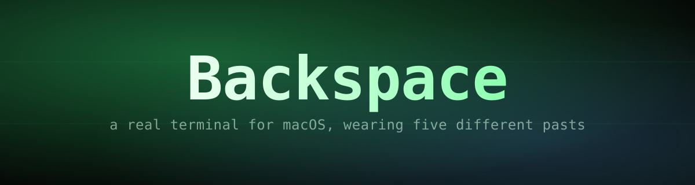

<p align="center">
  
</p>

<p align="center">
  
  
  
  
</p>

A real terminal for macOS — your actual shell, your actual tools — dressed up
as five machines that no longer exist: a phosphor-green Matrix console, DOS's
`CMD`, PowerShell's blue, Midnight Commander's cyan, and a clean Windows
Terminal. Bitmap fonts, scanlines, CRT glow and a PC-speaker beep synthesized
live, no audio files involved.

## Index

- [Why](#why)
- [Installation](#installation)
- [Themes](#themes)
- [Shortcuts](#shortcuts)
- [Sound](#sound)
- [How your shell is loaded](#how-your-shell-is-loaded)
- [Project layout](#project-layout)
- [Adding a theme](#adding-a-theme)
- [License](#license)

## Why

Modern terminals are fast and legible, which is exactly why they all look the
same. Backspace is the opposite bet: keep your real shell — `zoxide`, `bat`,
`eza`, `fzf`, `nvm`, autosuggestions, your aliases and functions, all of it —
but let the *window* belong to 1983, 1995 or 2001 for a while.

- A **real pty** (`node-pty` + `xterm.js`), not a themed screenshot.
- Your `~/.zshrc` loads in full; only the **prompt** is swapped for a plain
  one, so Ghostty and every other terminal keep Starship exactly as before.
- **Bitmap fonts** rendered pixel-perfect (antialiasing off), not a monospace
  font pretending to be one.
- A **synthesized PC-speaker beep** per keystroke, no sample files.

## Installation

```bash
git clone https://github.com/alexcalatyd/backspace.git
cd backspace
npm install
npm start
```

If `node-pty` fails to load after a Node or Electron update:

```bash
npm run rebuild
```

## Themes

| Theme | Font | Look | Sound |
|---|---|---|---|
| Matrix | Share Tech Mono | green phosphor, katakana rain, scanlines | sharp beeps + chatter |
| CMD Retro | IBM VGA 9x16 (bitmap) | black, white text, green glow, scanlines | 750 Hz BEL + chatter |
| PowerShell | IBM VGA 9x16 (bitmap) | `#012456` blue, white text | soft beep |
| Commander | IBM EGA 8x14 (bitmap) | Midnight Commander blue/cyan | PC-speaker beeps |
| Windows Terminal | Cascadia (Nerd Font) | Campbell palette, no effects | muted |

## Shortcuts

| Key | Action |
|---|---|
| `⌘T` | new tab |
| `⌘W` | close tab |
| `⌘1`–`⌘9` | jump to tab |
| `⌘K` / `⇧⌘K` | next / previous theme |
| `⌘M` | mute / unmute sound |

## Sound

Synthesized live with WebAudio (`src/sfx.js`) — a dry square wave, PC-speaker
style. A beep per keystroke, a lower BEL on Enter, and a modem-like chatter
while a command runs. No audio files ship with the app. Muting is remembered
across launches.

## How your shell is loaded

Backspace launches `zsh` with `ZDOTDIR=./shell`. That isolated `.zshrc`
**sources your real `~/.zshrc` in full** and only then removes the prompt:

1. Your actual `~/.zshrc` runs — every tool, alias and function you use daily.
2. Starship's `precmd`/`preexec` hooks are stripped by pattern (not by exact
   name — newer Starship calls its hook `prompt_starship_precmd`), and
   `PROMPT='%~ %# '` is left blank.
3. `$TERMINAL_RETRO=1` is exported, in case you ever want a conditional in
   your own `~/.zshrc`.

Your real `~/.zshrc` is never touched — Ghostty and every other terminal keep
Starship exactly as they had it. Since this isn't a login shell, `~/.zprofile`
is never read either, so Homebrew's `PATH` is set directly in
`shell/.zshrc`. The `rterminal` alias is redefined inside this app to reload
`$ZDOTDIR/.zshrc` instead of `~/.zshrc`, otherwise Starship would reappear in
this window.

## Project layout

```
main.js          main process + pty (node-pty)
preload.js       secure bridge, main <-> renderer
src/index.html   UI shell
src/styles.css   chrome, scanlines, CRT glow
src/themes.js    theme definitions
src/renderer.js  tabs, xterm.js, shortcuts
src/rain.js      Matrix rain (canvas)
src/fonts/       VT323, Share Tech Mono, JetBrains Mono, bitmap VGA/EGA fonts
src/sfx.js       synthesized beeps (WebAudio)
shell/.zshrc     the app's isolated shell config
```

## Adding a theme

Add an entry to `src/themes.js` and its key to `THEME_ORDER` — that's it.

Bitmap fonts (CMD, PowerShell, Commander) come from IBM's VGA/EGA ROM dumps at
[int10h.org](https://int10h.org) (CC BY-SA 4.0) — the same source as
Windows's own **Terminal** bitmap font. At their native pixel size, with
antialiasing disabled, they snap cleanly to the 9×16 / 8×14 grid.

## License

MIT. See [LICENSE](LICENSE).
